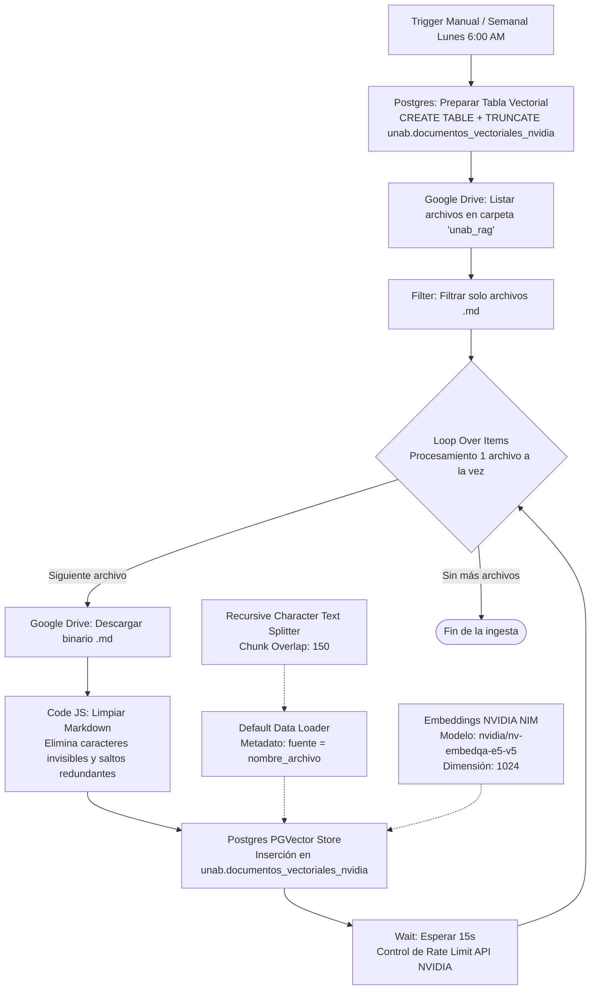

# Asistente Académico UNAB — Chatbot Híbrido (RAG + MCP + n8n + Expo Go)

Sistema inteligente de apoyo académico para estudiantes del programa de **Ingeniería de Sistemas** de la **Universidad Autónoma de Bucaramanga (UNAB)**. Combina búsqueda semántica (**RAG** con `pgvector`) sobre la normativa institucional (Reglamento Estudiantil de Pregrado y ruta de Competencias Digitales - CCD) con consultas transaccionales en tiempo real mediante un servidor **Model Context Protocol (FastMCP)** en AWS EC2, orquestado en **n8n** y consumido desde una aplicación móvil en **React Native / Expo Go**.

## Juan Alejandro Sierra Rincon - U00178520

---

## Arquitectura del Sistema

```text
┌─────────────────────────┐      HTTP POST (JSON)      ┌──────────────────────────────────────────┐
│   App Móvil (Expo Go)   │ ─────────────────────────▶ │              n8n (Orquestador)           │
│  React Native / Node.js │ ◀───────────────────────── │  Webhook ─▶ AI Agent ─▶ Respond Webhook  │
└─────────────────────────┘     Respuesta Asistente    └──────────────┬──────────────┬────────────┘
         │                                                            │              │
         │ Validación de acceso                                       │              │ RAG (Embeddings)
         │ (id_estudiante / email)                                    │              ▼
         ▼                                                            │   ┌──────────────────────┐
┌─────────────────────────┐                                           │   │  Supabase PGVector   │
│  Supabase PostgreSQL    │ ◀─────────── Client API (HTTPS) ──────────┼── │  (Reglamento + CCD)  │
│     Esquema: `unab`     │                                           │   └──────────────────────┘
└─────────────────────────┘                                           │
         ▲                                                            │ HTTP Streamable (:9000/mcp)
         │                                                            ▼
         │                 ┌──────────────────────────────────────────────────────┐
         └───────────────  │   Servidor FastMCP en Python (AWS EC2 t3.micro)      │
                           │   6 Herramientas Académicas + Alertas Reglamentarias │
                           └──────────────────────────────────────────────────────┘
```

### Stack Tecnológico
- **Base de Datos y Vectores:** Supabase (PostgreSQL + `pgvector`) con esquema personalizado `unab` y vistas analíticas (`v_estado_estudiante`, `v_cursos_pendientes`).
- **Servidor MCP:** Python 3, `FastMCP` (`mcp<2.0.0`), `supabase-py`, desplegado como servicio `systemd` en **AWS EC2 (`t3.micro`, Ubuntu)** sobre transporte `streamable-http` en el puerto `9000` con dominio dinámico **DuckDNS**.
- **Orquestación e IA:** **n8n** (`Webhook` $\rightarrow$ `AI Agent` $\rightarrow$ `Respond to Webhook`), modelo LLM (Google Gemini / OpenAI), memoria persistente en PostgreSQL (`Postgres Chat Memory`), herramienta vectorial (`Supabase Vector Store`) y cliente MCP (`MCP Client Tool`).
- **Cliente Móvil:** **Expo / React Native** (Expo Router) ejecutable en dispositivos físicos mediante **Expo Go**.

---

## Pipeline de Ingesta RAG y Generación de Embeddings (NVIDIA NIM)

Para alimentar la base de conocimiento institucional del agente (Reglamento Estudiantil de Pregrado, estructura del plan de estudios y documentación de Competencias Digitales - CCD), se implementó un pipeline automatizado en **n8n** (`UNAB - Ingesta RAG (NVIDIA NIM) - un archivo a la vez`) que procesa documentos Markdown desde Google Drive y almacena sus vectores en **Supabase (`pgvector`)**.

### Arquitectura del Flujo de Ingesta


---

## Guía de Implementación Paso a Paso

### Paso 1: Configuración de Base de Datos en Supabase

1. **Crear el esquema `unab` y las tablas principales:**
   - `unab.estudiantes`: Datos del estudiante (`id_estudiante`, `nombre`, `apellido`, `email`, `programa`, `semestre_actual`, `estado_matricula`, `periodo_ingreso`).
   - `unab.cursos`: Catálogo de asignaturas del plan de estudios (`tipo = 'plan'`) y ruta de Competencias Digitales (`tipo = 'competencia_digital'`, códigos `CD-101` a `CD-303` distribuidos en 3 pilares).
   - `unab.inscripciones`: Historial académico (`id_estudiante`, `codigo_curso`, `periodo`, `nota`, `estado`).
   - `unab.prerrequisitos`: Malla de dependencias entre cursos (`codigo_curso`, `codigo_requisito`).
   - `unab.noticias`: Novedades y convocatorias institucionales obtenidas por web scraping.
   - `unab.documentos_vectoriales`: Fragmentos (*chunks*) y embeddings (`pgvector`) del Reglamento Estudiantil de Pregrado y guías del CCD.

2. **Crear las vistas analíticas optimizadas:**
   - `unab.v_estado_estudiante`: Calcula créditos aprobados, porcentaje de avance, promedio general acumulado (PGA), materias en curso y proyección de semestres restantes.
   - `unab.v_cursos_pendientes`: Lista las materias faltantes del plan indicando mediante el booleano `prerrequisitos_cumplidos` si el estudiante ya puede inscribirlas.

3. **Exponer el esquema y otorgar permisos de API:**
   - En el panel de Supabase, ir a **Project Settings $\rightarrow$ API (Data API) $\rightarrow$ Exposed schemas** y agregar `unab` junto a `public`.
   - Ejecutar en el **SQL Editor** de Supabase:

```sql
GRANT USAGE ON SCHEMA unab TO postgres, anon, authenticated, service_role;
GRANT ALL ON ALL TABLES IN SCHEMA unab TO postgres, service_role;
GRANT SELECT ON ALL TABLES IN SCHEMA unab TO anon, authenticated;
GRANT ALL ON ALL SEQUENCES IN SCHEMA unab TO postgres, service_role;
GRANT USAGE, SELECT ON ALL SEQUENCES IN SCHEMA unab TO anon, authenticated;

ALTER DEFAULT PRIVILEGES IN SCHEMA unab GRANT ALL ON TABLES TO postgres, service_role;
ALTER DEFAULT PRIVILEGES IN SCHEMA unab GRANT SELECT ON TABLES TO anon, authenticated;
ALTER DEFAULT PRIVILEGES IN SCHEMA unab GRANT ALL ON SEQUENCES TO postgres, service_role;
```

---

### Paso 2: Despliegue del Servidor FastMCP en AWS EC2

1. **Configurar Seguridad y Dominio en AWS:**
   - En la consola de **AWS EC2 $\rightarrow$ Security Groups**, agregar una regla de entrada (**Inbound rule**):
     - **Type:** `Custom TCP` | **Port range:** `9000` | **Source:** `0.0.0.0/0` (o la IP del servidor n8n).
   - Configurar un subdominio gratuito en **DuckDNS** (ej. `tu-subdominio.duckdns.org`) apuntando a la IP pública de la instancia EC2 (`t3.micro` Ubuntu).

2. **Instalar y configurar el servidor en la instancia Ubuntu:**

```bash
sudo apt update && sudo apt install -y python3-venv python3-pip
mkdir -p ~/mcp-unab && cd ~/mcp-unab

# Copiar server.py y requirements.txt al directorio
python3 -m venv venv
source venv/bin/activate
pip install --upgrade pip
pip install "mcp[cli]>=1.6.0,<2.0.0" supabase>=2.10.0 python-dotenv>=1.0.1
```

3. **Configurar variables de entorno (`~/mcp-unab/.env`):**

```env
SUPABASE_URL=https://TU_PROJECT_ID.supabase.co
SUPABASE_KEY=sb_secret_TU_LLAVE_SECRETA_DE_SUPABASE
MCP_HOST=0.0.0.0
MCP_PORT=9000
```

4. **Configurar como servicio persistente (`systemd`):**

```bash
sudo tee /etc/systemd/system/mcp-unab.service > /dev/null <<EOF
[Unit]
Description=Servidor FastMCP UNAB Ingenieria de Sistemas
After=network.target

[Service]
User=ubuntu
WorkingDirectory=/home/ubuntu/mcp-unab
EnvironmentFile=/home/ubuntu/mcp-unab/.env
ExecStart=/home/ubuntu/mcp-unab/venv/bin/python /home/ubuntu/mcp-unab/server.py
Restart=always
RestartSec=5

[Install]
WantedBy=multi-user.target
EOF

sudo systemctl daemon-reload
sudo systemctl enable mcp-unab
sudo systemctl start mcp-unab
sudo systemctl status mcp-unab
```

#### Herramientas expuestas por el servidor MCP (`server.py`)
| Herramienta (`@mcp.tool`) | Descripción funcional |
| :--- | :--- |
| `consultar_estado_academico` | Consulta PGA, créditos, avance porcentual, semestres restantes y emite alertas automáticas de prueba académica (`PGA < 3.00`) o estado condicional (`3.00 - 3.20`). |
| `consultar_historial_cursos` | Devuelve asignaturas aprobadas, reprobadas o en curso filtrables por estado y tipo (`plan` o `competencia_digital`). |
| `consultar_materias_pendientes_y_matricula` | Lista asignaturas pendientes del plan e identifica cuáles tienen prerrequisitos cumplidos para el próximo semestre. |
| `verificar_prerrequisitos_curso` | Evalúa si un estudiante cumple los requisitos exactos para inscribir un código de curso específico. |
| `consultar_competencias_digitales` | Muestra el progreso en los 3 pilares de Competencias Digitales (`CD-101` a `CD-303`) para la insignia digital. |
| `consultar_noticias_unab` | Recupera las últimas noticias, convocatorias y cursos scrapeados de la UNAB. |

---

### Paso 3: Configuración del Flujo en n8n

1. **Crear el workflow conversacional con la siguiente estructura:**
   - **Nodo 1 — `Webhook`:** Método `POST`, Path `chat-unab`, modo de respuesta **`Using 'Respond to Webhook' Node`**.
   - **Nodo 2 — `AI Agent` (Tools Agent):**
     - **User Message:**
       ```text
       ID del estudiante autenticado: {{ $json.body.id_estudiante }}
       Pregunta del estudiante: {{ $json.body.mensaje }}
       ```
     - **System Message:** Instrucciones de rol académico UNAB, uso obligatorio de herramientas MCP para datos del estudiante, consulta al RAG para reglamento y explicación de alertas reglamentarias.
   - **Sub-nodos conectados al `AI Agent`:**
     - **Chat Model:** `Google Gemini Chat Model` (ej. `gemini-2.5-flash` / `gemini-3.5-flash`) u `OpenAI Chat Model` (`gpt-4o-mini`).
     - **Memory:** `Postgres Chat Memory` conectado a Supabase usando `{{ $('Webhook').item.json.body.sessionId }}` como Session ID.
     - **Tool 1 (`MCP Client Tool`):** Transporte `HTTP Streamable`, Endpoint `http://tu-subdominio.duckdns.org:9000/mcp`, Authentication `None`, Tools `All`.
     - **Tool 2 (`Supabase Vector Store`):** Modo *Retrieve Documents (As Tool)* apuntando a `unab.documentos_vectoriales` con el mismo modelo de embeddings usado en la ingesta.
   - **Nodo 3 — `Respond to Webhook`:** Responde en formato JSON:
     ```json
     {
       "respuesta": "{{ $json.output }}"
     }
     ```
2. **Activar el workflow** en n8n (*Active / Published*) para habilitar la **Production URL** (`https://tu-subdominio.duckdns.org/webhook/chat-unab`).

---

### Paso 4: Ejecución de la Aplicación Móvil (Expo Go)

1. **Instalar dependencias en la carpeta `UnabChat`:**

```bash
cd UnabChat
npm install
```

2. **Configurar variables de entorno (`UnabChat/.env`):**

```env
EXPO_PUBLIC_SUPABASE_URL=https://TU_PROJECT_ID.supabase.co
EXPO_PUBLIC_SUPABASE_ANON_KEY=sb_publishable_TU_LLAVE_PUBLICA_DE_SUPABASE
EXPO_PUBLIC_N8N_WEBHOOK_URL=https://tu-subdominio.duckdns.org/webhook/chat-unab
```

3. **Iniciar el servidor de desarrollo de Expo:**

```bash
npx expo start
```

4. **Probar en el celular:**
   - Descarga **Expo Go** en Android (Google Play) o iOS (App Store).
   - Escanea el código QR generado en la terminal.
   - Ingresa un `id_estudiante` o `email` registrado en `unab.estudiantes` para validar el acceso y comenzar a interactuar con el asistente académico.

---

## Autores y Contexto Académico
Proyecto desarrollado para la asignatura de **Ciencia de Datos** — Programa de **Ingeniería de Sistemas**, **Universidad Autónoma de Bucaramanga (UNAB)**.
